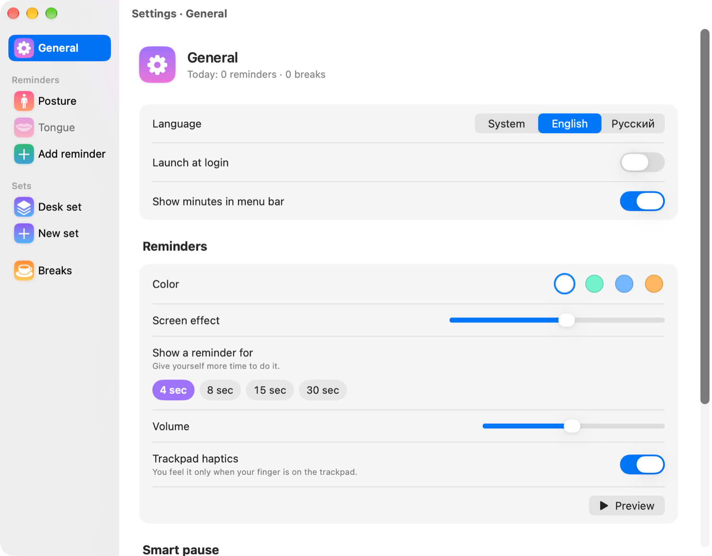
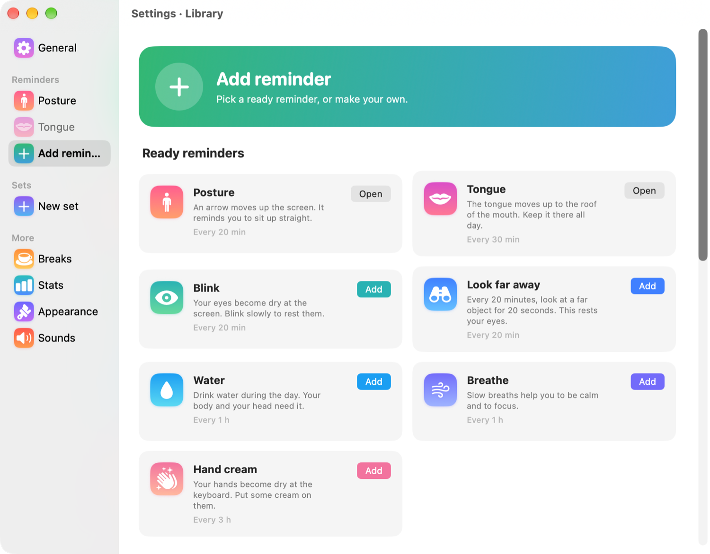
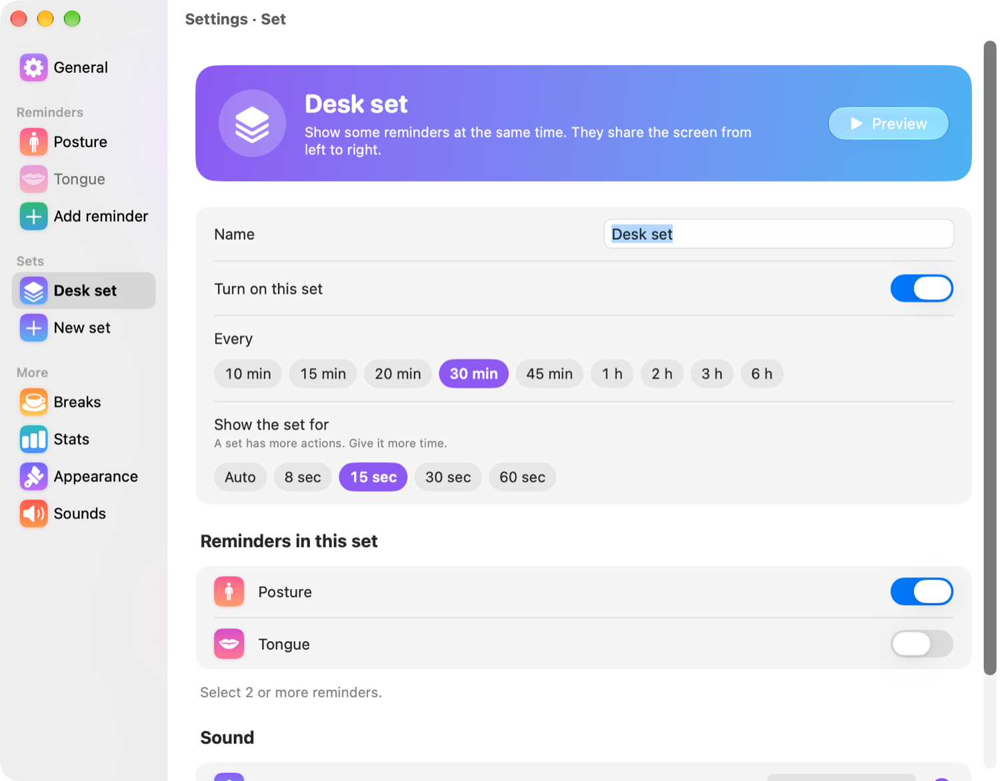
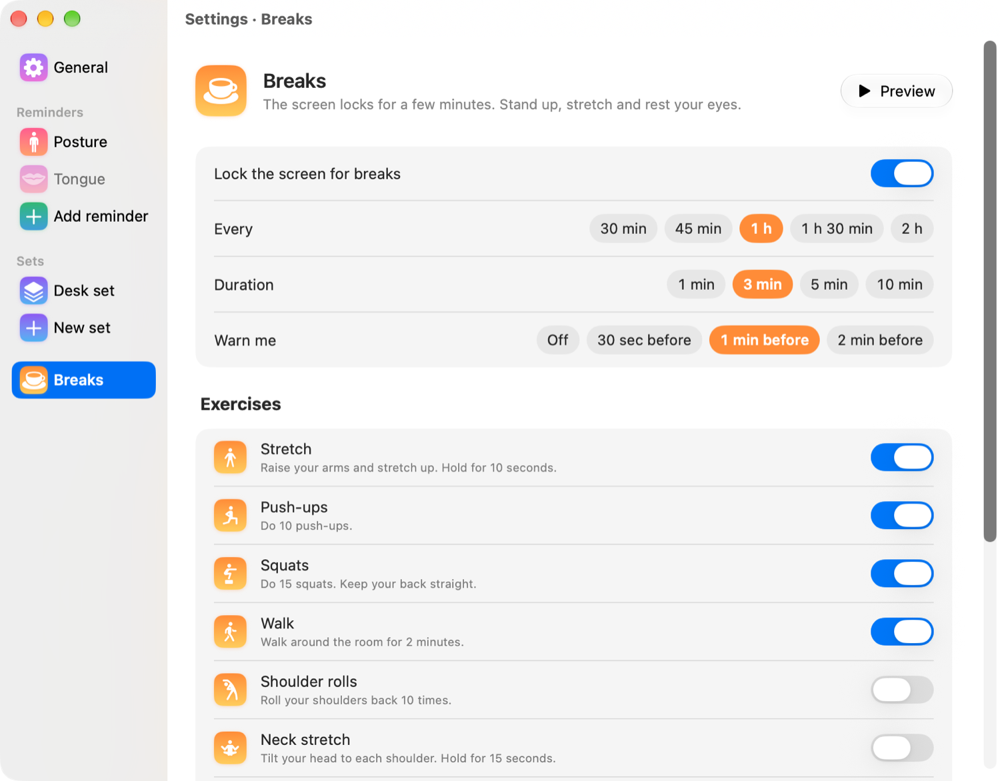

# Pinok

**English** · [Русский](README.ru.md)

Pinok is a small Mac app in the menu bar. It gives you a soft push to take care of your body at the computer: sit up straight, keep your tongue up, blink, drink water, and take breaks.


## What the app can do

### Short reminders

A reminder shows on the screen for a few seconds. The screen becomes a little darker, and an animation moves up the screen. A short melody plays, and the trackpad clicks softly. You can click and type at this time.

Short reminders are for things that you can do at the desk in a few seconds:

| Reminder | What you do |
|---|---|
| Posture | Sit up straight. |
| Tongue | Put your tongue on the roof of your mouth. |
| Blink | Blink slowly 10 times. |
| Look far away | Look at a far object for 20 seconds. |
| Water | Drink some water. |
| Breathe | Take 3 slow breaths. |
| Hand cream | Put cream on your hands. |

You can also make your own reminder. Write a name and a text, and pick an animation and a melody. A reminder can show every 10 minutes to every 6 hours.


### Combos

Put some reminders in a combo. They show at the same time and share the screen from left to right. Thus, you get one reminder instead of three.

A combo has more actions, so you can show it for longer: 8, 15, 30 or 60 seconds. A ring around each icon shows the time that is left.


### Breaks

At the time that you set, the screen locks for 1 to 10 minutes. The break shows a list of exercises, for example push-ups and squats. Click each exercise when you do it. When the list is done, click **Done. Continue**.

You can always skip the break or start it 1, 5 or 10 minutes later.


### Welcome screen

When you start Pinok for the first time, a short welcome shows on the full screen. Choose the language and the first reminders.


### More

- The menu bar shows the minutes to the next break.
- Before a break, a warning shows at the top of the screen.
- The app waits when you type, when you are in a call, or when a video is in full screen.
- The app stops when you are away or when the Mac sleeps.
- You can change the color, the screen effect, the melodies and the break background. You can use your own sound file.
- The app follows the Mac settings for less motion and less transparency.
- The app is in English and Russian.

## How to use Pinok

Here are some ways to set up the app. Start with one, and change it later.

### Work at the desk all day

- **Posture** every 20 minutes.
- **Tongue** every 30 minutes.
- **Break** every 60 minutes for 5 minutes, with 2 exercises.

### Eyes become tired

- Make a combo with **Blink** and **Look far away**.
- Show the combo every 20 minutes for 30 seconds.
- This is the 20-20-20 rule: every 20 minutes, look 20 feet (6 meters) away for 20 seconds.

### One reminder for many habits

- Make a combo with **Posture**, **Water** and **Breathe**.
- Show the combo every 45 minutes for 15 seconds.
- You get one short stop, not three.

### Move more

- Set breaks every 45 minutes for 3 minutes.
- Turn on **Push-ups**, **Squats** and **Walk**, and pick 2 exercises in one break.
- Turn on **End the break only when the list is done**. The break stays until you click each exercise.

### Many calls in a day

- Keep **Pause during calls** on. When the microphone or camera is on, Pinok waits.
- After the call, reminders come back one by one, not all at the same time.

## The menu bar panel

Click the ↑ icon in the menu bar to open the panel. The panel has 2 tabs: **Now** and **Stats**.

### Now

The **Now** tab shows the time to the next break. Short reminders do not have a timer here.

- Click **Start now** to start the break now.
- Click **+1 min**, **+5 min** or **+10 min** to move the break.
- Click **1 min**, **5 min** or **30 min** below **Pause** to stop all reminders and breaks for that time.

When the app is paused, the panel shows the time to the end of the pause. Click **Resume** to start again.


### Stats

The **Stats** tab shows your day:

- The time at the computer today.
- A line for the day in parts of 15 minutes: work, breaks and time away.
- The number of breaks, the number of skipped breaks, and the longest work time without a break.
- The apps that you used most today.


The app counts the time only when you use the keyboard or the mouse. It counts the time for the app in front. It does not record the screen and does not read the windows. All data stays on your Mac.

## Settings

Settings have 4 parts: General, Short reminders, Combos and Long breaks.

| General | Add a reminder |
|---|---|
|  |  |

| A combo | Breaks |
|---|---|
|  |  |

## Install

1. Open `Pinok-<version>.pkg` and follow the steps.
2. The app goes into Applications and starts.
3. Find the ↑ icon in the menu bar.

The app does not have an Apple signature. Thus, macOS can stop it the first time. If this occurs, right-click the file and click **Open**.

## Build from the source code

You must have macOS 26 and Xcode 26 or newer.

1. Build the app:

   ```bash
   ./build.sh
   ```

2. Start the app:

   ```bash
   open build/Pinok.app
   ```

3. To make an installer, do this step:

   ```bash
   ./scripts/make-pkg.sh
   ```

   The file is `build/Pinok-<version>.pkg`.

   To make a disk image (DMG) instead, use `./scripts/make-dmg.sh`.

4. To run the tests, do this step:

   ```bash
   swift test --no-parallel
   ```
