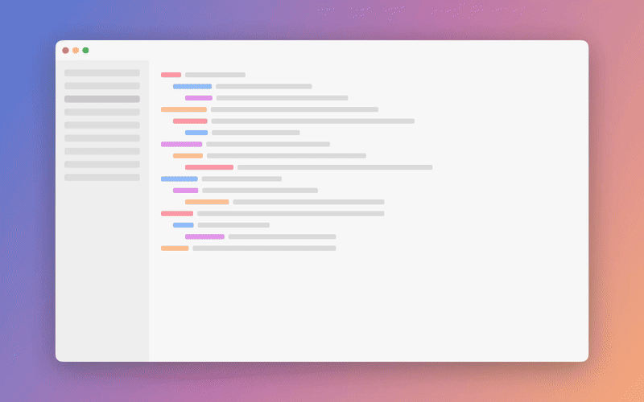
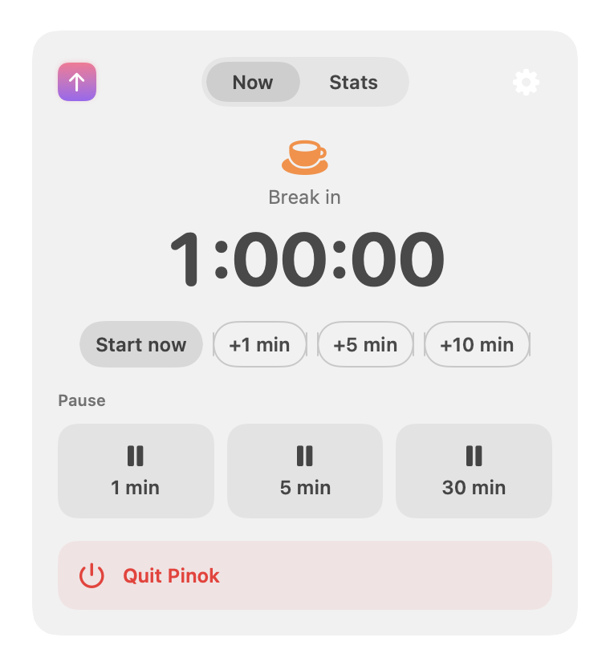
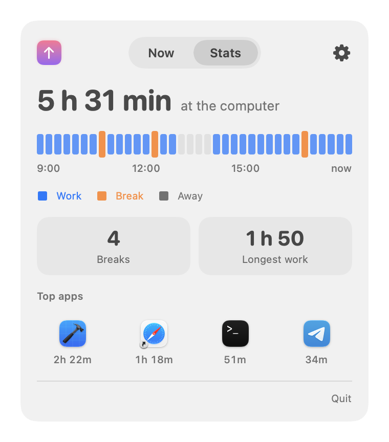

# Pinok

**English** · [Русский](README.ru.md)

Pinok is a small Mac app in the menu bar. It tells you to sit up straight, keep your tongue up, blink, drink water and take breaks.


## Features

- **Short reminders.** An animation shows on the screen for a few seconds. You can continue to type and click. There are 7 reminders: posture, tongue, blink, look far away, water, breathe and hand cream. You can also make your own reminder.
- **Combos.** Some reminders show together, so you stop one time, not three.
- **Breaks.** The screen locks for 1 to 10 minutes and shows a list of exercises. You can skip the break or move it by 1, 5 or 10 minutes.
- **Smart pause.** The app waits when you type, when you are in a call or when a video is in full screen. It stops when you are away.
- English and Russian.



## The menu bar panel

- **Now** shows the time to the next break. You can start the break now, move it, or pause the app for 1, 5 or 30 minutes.
- **Stats** shows your day: the time at the computer, work and breaks on a time line, and the apps that you used most.

The app counts the time only on your Mac. It does not record the screen.

| Now | Stats |
|---|---|
|  |  |

## Install

1. Open `Pinok-<version>.pkg`.
2. Find the ↑ icon in the menu bar.

The app does not have an Apple signature. If macOS stops the app, right-click the file and click **Open**.

## Build

You must have macOS 26 and Xcode 26 or newer.

```bash
./build.sh                 # build/Pinok.app
./scripts/make-pkg.sh      # build/Pinok-<version>.pkg
swift test --no-parallel   # tests
```
