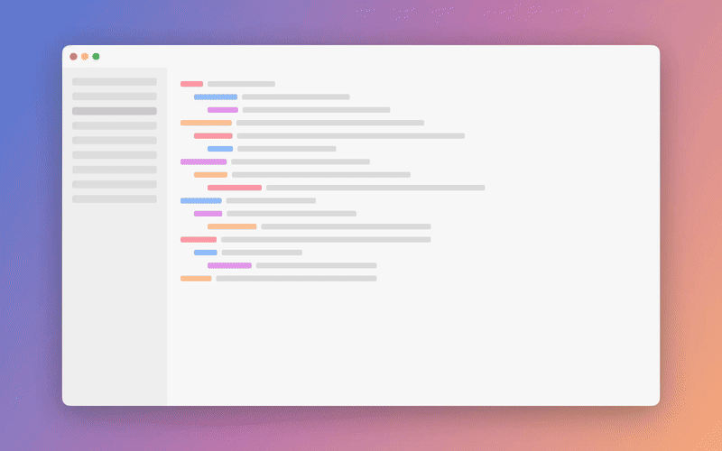
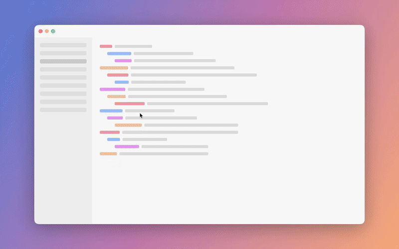
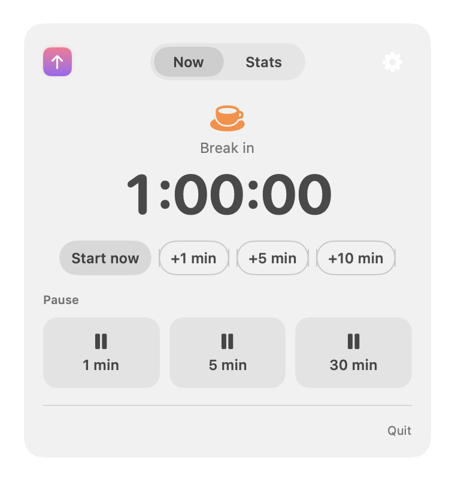
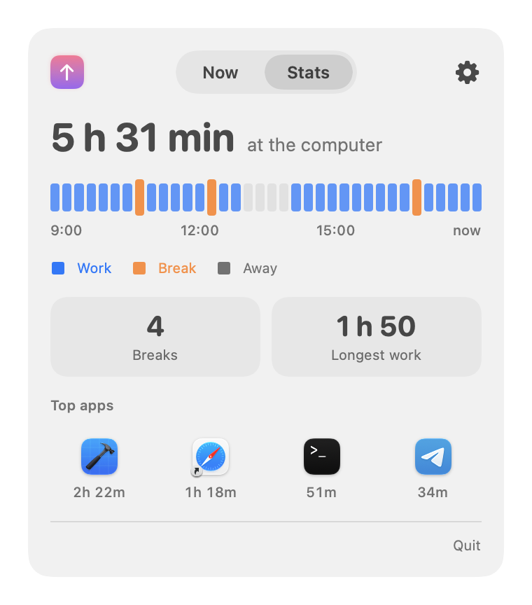
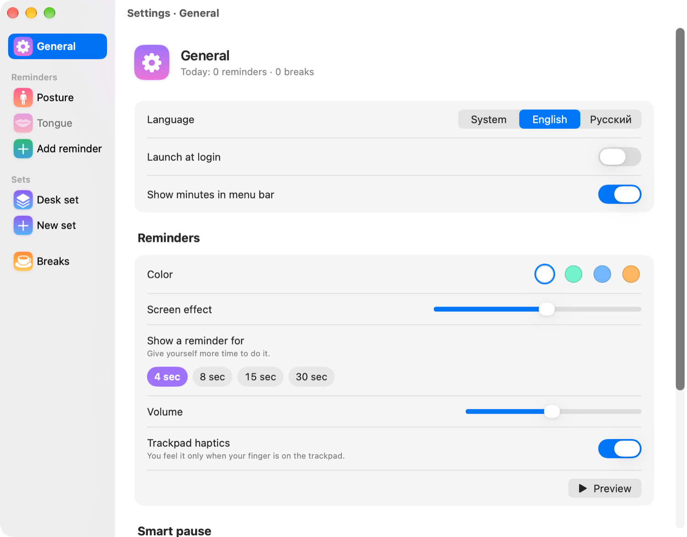
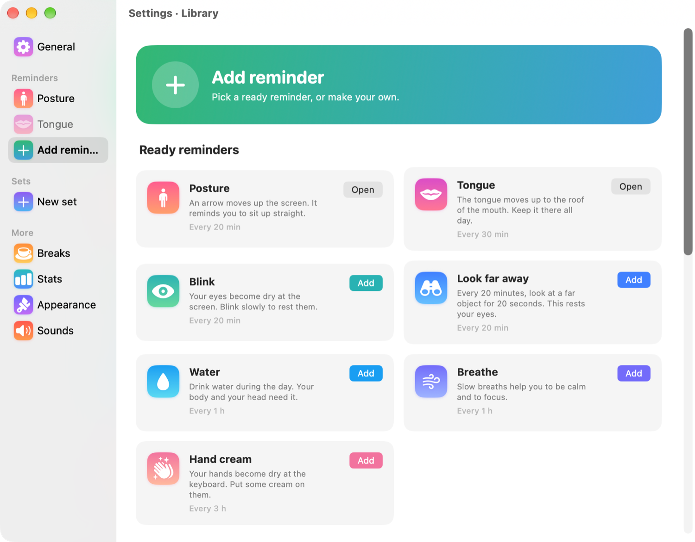
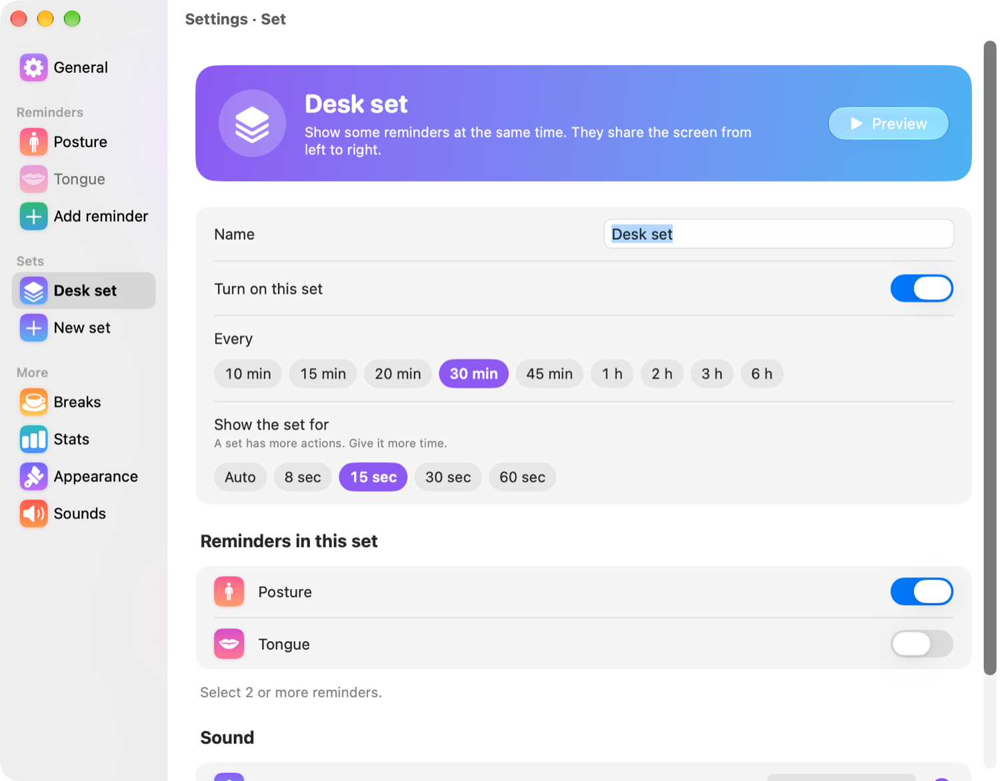
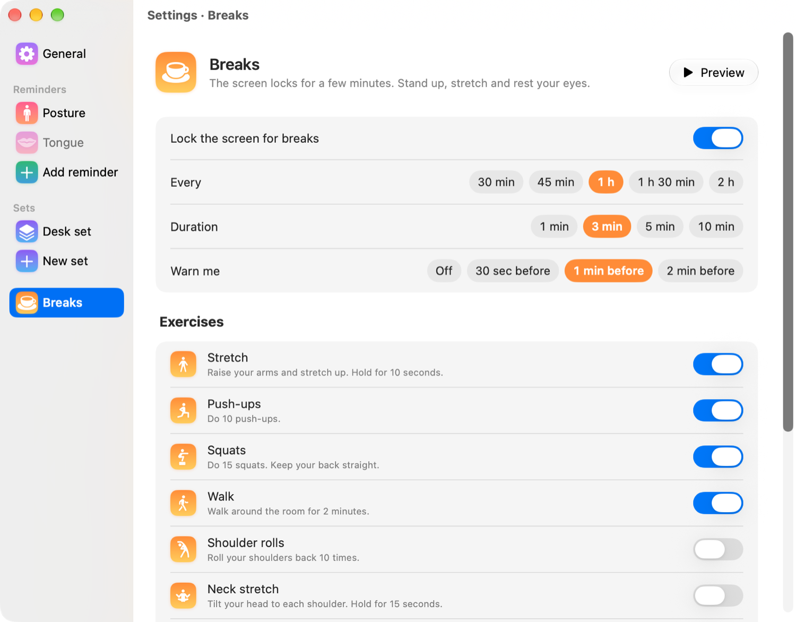

# Pinok

[English](README.md) · **Русский**

Pinok — маленькое приложение для Mac в строке меню. Оно мягко напоминает заботиться о теле за компьютером: сидеть ровно, держать язык у нёба, моргать, пить воду и делать перерывы.


## Что умеет приложение

### Короткие напоминания

Напоминание появляется на экране на несколько секунд. Экран чуть темнеет, по нему вверх идёт анимация. Играет короткая мелодия, трекпад мягко щёлкает. В это время можно дальше кликать и печатать.

Короткие напоминания — для того, что можно сделать за столом за пару секунд:

| Напоминание | Что сделать |
|---|---|
| Осанка | Сесть ровно. |
| Язык | Прижать язык к нёбу. |
| Моргнуть | Медленно моргнуть 10 раз. |
| Посмотреть вдаль | 20 секунд смотреть на дальний предмет. |
| Вода | Выпить воды. |
| Дыхание | Сделать 3 медленных вдоха. |
| Крем для рук | Нанести крем на руки. |

Можно сделать своё напоминание: написать название и текст, выбрать анимацию и мелодию. Напоминание может приходить от раза в 10 минут до раза в 6 часов.


### Комбо

Несколько напоминаний можно собрать в комбо. Они появляются одновременно и делят экран слева направо. Так вместо трёх напоминаний приходит одно.

В комбо больше действий, поэтому его можно показывать дольше: 8, 15, 30 или 60 секунд. Кольцо вокруг каждой иконки показывает, сколько времени осталось.


### Перерывы

В заданное время экран блокируется на 1–10 минут. На перерыве показывается список упражнений, например отжимания и приседания. Отмечай каждое, когда сделаешь. Когда список закончен, нажми **Готово. Дальше**.

Перерыв всегда можно пропустить или отложить на 1, 5 или 10 минут.



### Приветствие

При первом запуске Pinok на весь экран показывается короткое приветствие. В нём выбираются язык и первые напоминания.



### Ещё

- В строке меню видно, сколько минут до перерыва.
- Перед перерывом сверху экрана появляется предупреждение.
- Приложение ждёт, пока ты печатаешь, говоришь по звонку или смотришь видео на весь экран.
- Приложение останавливается, когда тебя нет за компьютером или Mac спит.
- Можно менять цвет, эффект экрана, мелодии и фон перерыва. Можно поставить свой звуковой файл.
- Приложение учитывает настройки Mac «Уменьшить движение» и «Уменьшить прозрачность».
- Приложение на английском и русском.

## Как пользоваться

Несколько готовых настроек. Начни с одной, потом поменяешь.

### Весь день за столом

- **Осанка** каждые 20 минут.
- **Язык** каждые 30 минут.
- **Перерыв** каждые 60 минут на 5 минут, 2 упражнения.

### Устают глаза

- Сделай комбо из **Моргнуть** и **Посмотреть вдаль**.
- Показывай его каждые 20 минут по 30 секунд.
- Это правило 20-20-20: каждые 20 минут 20 секунд смотреть на 6 метров вдаль.

### Одно напоминание на несколько привычек

- Сделай комбо из **Осанки**, **Воды** и **Дыхания**.
- Показывай его каждые 45 минут по 15 секунд.
- Одна короткая остановка вместо трёх.

### Больше двигаться

- Поставь перерывы каждые 45 минут на 3 минуты.
- Включи **Отжимания**, **Приседания** и **Прогулку**, по 2 упражнения за перерыв.
- Включи **Заканчивать перерыв только после списка**. Перерыв не закончится, пока не отметишь каждое упражнение.

### Много звонков за день

- Оставь включённой **Паузу во время звонков**. Пока работает микрофон или камера, Pinok ждёт.
- После звонка напоминания возвращаются по одному, а не все сразу.

## Панель в строке меню

Нажми на иконку ↑ в строке меню, чтобы открыть панель. В ней 2 вкладки: **Сейчас** и **Статистика**.

### Сейчас

Вкладка **Сейчас** показывает, сколько осталось до перерыва. Таймеров коротких напоминаний здесь нет.

- **Сейчас** — начать перерыв сразу.
- **+1 мин**, **+5 мин**, **+10 мин** — отложить перерыв.
- **1 мин**, **5 мин**, **30 мин** под словом **Пауза** — остановить все напоминания и перерывы на это время.

На паузе панель показывает, сколько осталось до её конца. Нажми **Продолжить**, чтобы снять паузу.



### Статистика

Вкладка **Статистика** показывает твой день:

- сколько времени ты сегодня за компьютером;
- ленту дня по 15 минут: работа, перерывы и время без компьютера;
- сколько перерывов сделано и пропущено, и самый долгий отрезок работы без перерыва;
- в каких приложениях ты сегодня провёл больше всего времени.



Время считается только тогда, когда ты пользуешься клавиатурой или мышью, и записывается на приложение, которое сейчас впереди. Pinok не записывает экран и не читает содержимое окон. Все данные остаются на твоём Mac.

## Настройки

В настройках 4 раздела: Общие, Короткие напоминания, Комбо и Долгие перерывы.

| Общие | Добавить напоминание |
|---|---|
|  |  |

| Комбо | Перерывы |
|---|---|
|  |  |

Скриншоты настроек на английском. Язык приложения переключается в настройках.

## Установка

1. Открой `Pinok-<версия>.pkg` и пройди шаги установщика.
2. Приложение попадёт в «Программы» и запустится.
3. Найди иконку ↑ в строке меню.

У приложения нет подписи Apple, поэтому при первом запуске macOS может его остановить. Тогда нажми на файл правой кнопкой и выбери **Открыть**.

## Сборка из исходников

Нужны macOS 26 и Xcode 26 или новее.

1. Собери приложение:

   ```bash
   ./build.sh
   ```

2. Запусти его:

   ```bash
   open build/Pinok.app
   ```

3. Чтобы сделать установщик:

   ```bash
   ./scripts/make-pkg.sh
   ```

   Файл появится в `build/Pinok-<версия>.pkg`.

   Чтобы сделать образ диска (DMG), запусти `./scripts/make-dmg.sh`.

4. Чтобы запустить тесты:

   ```bash
   swift test --no-parallel
   ```
